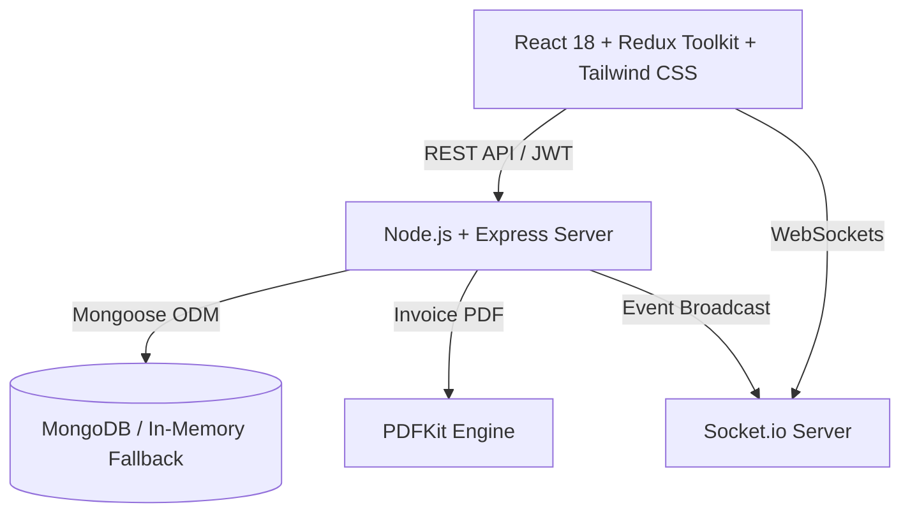

# 🚚 Tracely | Transport Management System (TMS)

> **Enterprise-grade MERN Stack Logistics & Lorry Fleet Management Platform**  
> Built for road freight carriers, fleet operators, logistics brokers, and commercial lorry transportation networks.

---

## 🌟 Key Features

### 1. Fleet & Vehicle Management
- Track complete lorry profiles: Registration Plate, Vehicle Type (Heavy Trailer, Container Truck, Flatbed, Liquid Tanker, Tipper), Payload Capacities (kg & m³ volume), and Odometer Mileage.
- Real-time status toggling: `Available`, `On Trip`, `Maintenance`, `Inactive`.
- Service and preventive maintenance log records.

### 2. Commercial Driver Management
- Heavy vehicle driver profiles linked with authentication credentials.
- Track Commercial Driving License (CDL) numbers, validity, and experience years.
- Safety performance score and customer ratings (1.0 to 5.0 ⭐).
- Availability and duty roster tracking (`Available`, `On Trip`, `On Leave`, `Inactive`).

### 3. Shipment Booking & Automated Freight Pricing
- Shipper booking pipeline with origin pickup, destination delivery, and cargo specifications.
- **Built-in Dynamic Pricing Engine**: Automatically calculates freight quotes based on distance (km), cargo weight (tonnes), base vehicle rate, and taxes.
- Complete booking lifecycle: `Draft` → `Confirmed` → `Assigned` → `In Progress` → `Completed` / `Cancelled`.

### 4. Vehicle & Driver Assignment Workflow
- Dispatch operators can pair available trucks and standby drivers to active bookings with capacity checks.
- Automatically generates unique tracking numbers (`TRIP-XXXXXX`).

### 5. Real-Time Trip Tracking & Live Map
- Interactive GPS tracking powered by Leaflet & OpenStreetMap tiles (no Google Maps API key required).
- Live breadcrumb polyline, origin marker, destination flag, and animated vehicle positioning.
- Real-time WebSocket synchronization (`Socket.io`) for instant vehicle location broadcasts.
- Transit lifecycle stepper: `Booked` → `Loading` → `Dispatched` → `In Transit` → `Unloading` → `Delivered`.
- **Proof of Delivery (POD)**: Digital upload of receiver signatures and cargo delivery photos.

### 6. Trip Expense & Reimbursement Module
- On-road expense claims logged by drivers (Diesel/Fuel, Highway Tolls, Emergency Repairs, Daily Allowance).
- Manager audit workflow with one-click `Approve` or `Reject` with remarks.
- Seamlessly attached to trips for calculating true net freight margins.

### 7. Automated Invoicing & Billing
- Automated tax and line-item invoice generation upon delivery completion.
- One-click **PDF Invoice Generation** using `PDFKit` directly downloadable from the UI or API.
- Payment reconciliation (`Unpaid`, `Partially Paid`, `Paid`, `Overdue`) with transaction reference tracking.

### 8. Role-Based Dashboards & Portals
- 👑 **Admin Portal**: Executive overview, revenue vs operating expense trend charts, fleet utilization pie chart, and system audit logs.
- 💼 **Fleet Manager Portal**: Dispatch queue, quick vehicle assignment modal, driver roster, and expense approval pipeline.
- 🚚 **Driver Mobile-Optimized Cockpit**: Current active trip banner, stage progression buttons, one-click GPS ping transmission, on-road expense claim, and POD upload.

---

## 🏗️ Architecture & Tech Stack



- **Frontend**: React 18, Vite, Redux Toolkit, React Router v7, Tailwind CSS, Lucide Icons, Recharts, Leaflet, React Hot Toast.
- **Backend**: Node.js, Express.js, MongoDB (with automated `mongodb-memory-server` zero-config fallback), Mongoose, Socket.io, JWT, bcryptjs, Multer, PDFKit.
- **Maps**: Leaflet with OpenStreetMap / CARTO voyager tiles (100% free, zero external API keys needed).

---

## ⚡ Quick Start Guide

### Prerequisites
- Node.js (v18 or higher)
- npm (v9 or higher)

### 1. Installation
Clone the repository and install all dependencies for backend, frontend, and root:

```bash
# In the root project directory:
npm run install:all
```

Or install individually:
```bash
# Root
npm install

# Backend
cd backend && npm install

# Frontend
cd ../frontend && npm install
```

### 2. Configure Environment Variables

**Backend (`backend/.env`):**
```env
PORT=5000
NODE_ENV=development
MONGO_URI=mongodb://localhost:27017/tracely_tms
JWT_SECRET=tracely_super_secret_jwt_key_2026_production
JWT_EXPIRE=30d
CLIENT_URL=http://localhost:5173
```
*(Note: If no local MongoDB is running on port 27017, Tracely automatically spins up an in-memory database and seeds mock data automatically!)*

**Frontend (`frontend/.env`):**
```env
VITE_API_URL=/api
VITE_SOCKET_URL=http://localhost:5000
```

### 3. Run Development Servers

Run both Backend and Frontend concurrently with one command from the project root:

```bash
npm run dev
```

The application will be live at:
- **Frontend App**: [http://localhost:5173](http://localhost:5173)
- **Backend API**: [http://localhost:5000](http://localhost:5000)
- **API Health Check**: [http://localhost:5000/api/health](http://localhost:5000/api/health)

---

## 🔐 Demo Credentials (1-Click Login Available)

On the login page, you can either click the **Quick Demo Buttons** or enter credentials manually:

| Role | Email | Password | Access Scope |
| :--- | :--- | :--- | :--- |
| **Admin** | `admin@tracely.com` | `admin123` | Complete system control, analytics, financial records, all modules |
| **Fleet Manager** | `manager@tracely.com` | `manager123` | Fleet vehicles, drivers, bookings, trip dispatch, expense approvals |
| **Lorry Driver** | `driver@tracely.com` | `driver123` | Assigned trip cockpit, GPS simulation, expense submission, POD upload |

---

## 📡 API Endpoints Reference

### Authentication (`/api/auth`)
- `POST /api/auth/register` - Create new user account
- `POST /api/auth/login` - Authenticate & receive JWT token
- `GET  /api/auth/me` - Get current logged-in user profile
- `PUT  /api/auth/profile` - Update profile name and phone
- `PUT  /api/auth/password` - Update account password

### Vehicles (`/api/vehicles`)
- `GET    /api/vehicles` - List vehicles (pagination, filter by status & type)
- `GET    /api/vehicles/available` - Get standby vehicles ready for assignment
- `GET    /api/vehicles/:id` - Get vehicle details
- `POST   /api/vehicles` - Register new vehicle (Admin/Manager)
- `PUT    /api/vehicles/:id` - Update vehicle specifications
- `DELETE /api/vehicles/:id` - Remove vehicle from fleet

### Drivers (`/api/drivers`)
- `GET    /api/drivers` - List commercial drivers
- `GET    /api/drivers/available` - Standby drivers available for trips
- `GET    /api/drivers/:id` - Driver profile with assigned vehicle
- `POST   /api/drivers` - Register new driver & auto-create login account
- `PUT    /api/drivers/:id` - Update driver record
- `DELETE /api/drivers/:id` - Remove driver

### Bookings (`/api/bookings`)
- `GET    /api/bookings` - List shipment bookings
- `GET    /api/bookings/:id` - Booking details
- `POST   /api/bookings` - Create new shipment order
- `POST   /api/bookings/calculate-rate` - Dynamic freight calculation engine
- `PUT    /api/bookings/:id` - Update booking
- `PUT    /api/bookings/:id/cancel` - Cancel booking

### Trips (`/api/trips`)
- `GET  /api/trips` - List trips
- `GET  /api/trips/:id` - Get trip with full route, vehicle, driver & timeline
- `POST /api/trips` - Assign vehicle & driver to booking (Initiates trip)
- `PUT  /api/trips/:id/status` - Advance trip status stage
- `PUT  /api/trips/:id/location` - Transmit real-time GPS coordinates
- `POST /api/trips/:id/pod` - Upload Proof of Delivery document

### Expenses (`/api/expenses`)
- `GET    /api/expenses` - List expenses
- `POST   /api/expenses` - Submit on-road expense claim
- `PUT    /api/expenses/:id/status` - Approve or reject claim (Manager/Admin)
- `DELETE /api/expenses/:id` - Delete expense claim

### Invoices (`/api/invoices`)
- `GET /api/invoices` - List invoices
- `GET /api/invoices/:id` - Get invoice details
- `GET /api/invoices/:id/pdf` - **Download official PDF Invoice**
- `PUT /api/invoices/:id/payment` - Update payment status

### Analytics & Reports (`/api/reports`)
- `GET /api/reports/dashboard` - KPI summary stats, monthly revenue, fleet breakdown
- `GET /api/reports/analytics` - Expense allocation, driver leaderboard, on-time rates

---

## 📄 License
ISC License. Built with ❤️ for modern logistics and transport operations.
